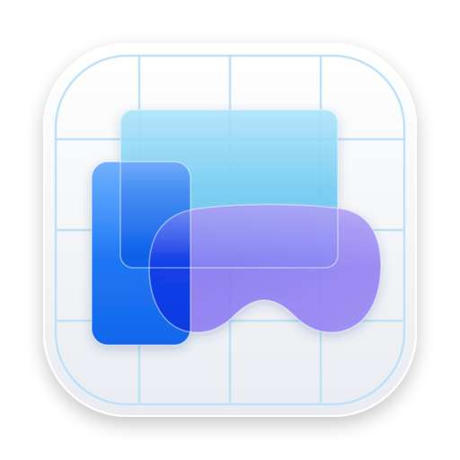

<p align="center">
  
</p>

<h1 align="center">iOS Simulator</h1>

<p align="center">
  <b>Run your iOS app in Android Studio, right next to the code.</b><br>
  A live, interactive simulator in a tool window. No window switching.
</p>

---

iOS Simulator docks a booted simulator in Android Studio the same way **Running Devices** shows the Android emulator. No more switching windows to test the iOS side of a Kotlin Multiplatform or Compose Multiplatform app.

## Features

- **Live screen** at up to 60 fps, with the device frame drawn around it.
- **Touch input**: click to tap, drag to swipe, scroll with the trackpad or mouse wheel.
- **Keyboard**: type straight into the simulator. `⌘V` pastes your Mac clipboard; `⌘A` `⌘C` `⌘X` `⌘Z` work on the device.
- **Hardware buttons**: Power, Volume, Home, App Switcher, plus clickable buttons on the device frame.
- **Rotate**, **screenshot** and **paste** from the toolbar.
- **Zoom**: Fit, Actual Size, zoom in and out.
- **Device picker**: lists every simulator; picking a shut-down one boots it.
- **Follows your runs**: running or debugging an iOS app opens the panel on that simulator and keeps the DeviceHub window (Simulator before Xcode 27) out of the way.
- **Recovers on its own** when the simulator restarts or the connection drops.

## Requirements

| | Supported | Tested |
|---|---|---|
| Mac | Apple silicon | Apple silicon |
| IDE | Android Studio 2025.1 (build 251) or newer | 2026.2 in use; 2025.1, 2026.1 and 2026.2 pass the Plugin Verifier |
| Xcode | 27.1, selected with `xcode-select` | 27.1 |
| Simulator | iOS 26.5 or iOS 27 runtime | iOS 26.5 and iOS 27 |

Untested combinations:

- **Xcode before 27.** The plugin opens Simulator.app instead of DeviceHub there, and the helper loads SimulatorKit from Xcode's older location, but no Xcode 26 run has confirmed it.
- **iOS runtimes before 26.5**, such as iOS 18.
- **Android Studio 2025.1 and 2026.1 at run time.** The Plugin Verifier finds no compatibility problems, but the plugin hasn't been opened in them.

## Install

**From JetBrains Marketplace:** Settings → Plugins → Marketplace → search **iOS Simulator**.

**From a zip:** download the latest release, then Settings → Plugins → ⚙ → **Install Plugin from Disk…**

## Usage

1. Open the **iOS Simulator** tool window on the right.
2. Pick a simulator from the list. It boots if it isn't running.
3. Click, type and scroll on the screen as you would on a device.

Running an iOS app opens the panel on the right simulator automatically.

### Shortcuts

| Action | Shortcut |
|---|---|
| Zoom in | `⌘=` |
| Zoom out | `⌘-` |
| Actual size | `⌘.` |
| Fit to panel | `⌘/` |
| Paste Mac clipboard | `⌘V` |

### Settings

Settings → Advanced Settings → **iOS Simulator**:

| Setting | Default |
|---|---|
| Max frame rate | 60 fps |
| JPEG quality | 70% |
| Shut down simulators when the project closes | Ask |
| DeviceHub window during runs | Hide |

The ⚙ button in the panel toolbar changes the same settings, applied as you change them, and can show a live frame-rate counter.

## Build from source

Needs JDK 25 and Xcode 27.1.

```sh
cd plugin
./gradlew runIde       # sandbox Android Studio with the plugin
./gradlew buildPlugin  # build/distributions/simpanel-<version>.zip
./gradlew test
```

Point `androidStudioPath` in `plugin/gradle.properties` at your Android Studio, or pass `-PandroidStudioPath=...`. When nothing is installed there, as on CI, Gradle downloads the release `androidStudioVersion` names instead.

### Project layout

```
helper/   Swift helper that streams the simulator screen and injects input
plugin/   Android Studio plugin (Kotlin), bundles the helper
icons/    Artwork
```

### Releasing

Bump `version` in `plugin/build.gradle.kts`, commit, then push a matching tag:

```sh
git tag v0.2.0 && git push origin v0.2.0
```